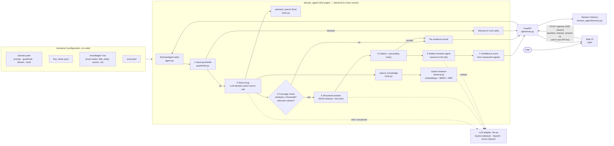
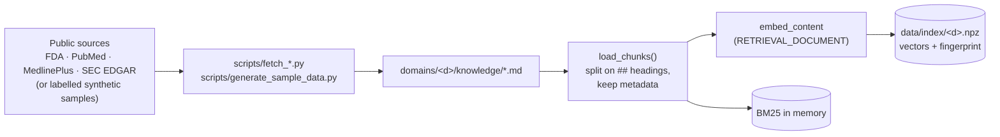

# Architecture

One engine, five sectors. A sector is **configuration + a knowledge folder** — adding or changing a sector never touches Python.

## System diagram



## The seven steps of one question

| # | Step | Code | LLM call? | What it guarantees |
|---|---|---|---|---|
| 1 | Input guardrails | `guardrails.check_input` | no | Domain-specific refusals (diagnosis, dosing, investment advice…), prompt-injection patterns |
| 2 | ReAct tool loop | `agent.ask` (≤3 steps) | yes | The model chooses what to search; one search per entity |
| 3 | Coverage check | `agent.ask`, `guardrails.uncovered_terms` | no | Weak or unknown-entity evidence ⇒ **"no evidence found"**, never a guess |
| 4 | Structured answer | `agent._answer_and_verify` | yes | JSON with `summary`, `findings[]` (each with `sources`, `severity`), `limitations` |
| 5 | Citation / grounding check | `guardrails.verify_answer` | no | Every cited id exists; every finding is textually supported by its source; one automatic repair try |
| 6 | Safety reviewer | `agent._review` | yes | A *separate* prompt that only looks for violations (individual advice, unsupported claims) |
| 7 | Confidence | `guardrails.compute_confidence` | no | Number computed from 4 measured signals (see [GUARDRAILS.md](GUARDRAILS.md)) |

Steps 1, 3, 5, 7 are plain Python, so they are fast, free, deterministic and unit-tested.

## Data flow of the knowledge base



The index carries a **fingerprint of the files and the embedding model**; changing either rebuilds it automatically.

## Repository layout

```
domain_agent/   the engine (7 small modules)         docs/        all documentation (this folder)
domains/<d>/    config + knowledge + eval per sector  api/         FastAPI server (SSE streaming)
scripts/        data fetchers, index builder, CLI     web/         static UI (HTML/CSS/JS, no build step)
eval/           harness + reports                     tests/       offline unit tests (no API key needed)
```

Code and documentation are deliberately in different folders: nothing under `docs/` is imported, and nothing under `domain_agent/` is documentation.

## Where each task requirement lives

See the live checklist in the web UI (**Checklist & spec**), generated from [`checklist.yaml`](checklist.yaml).
